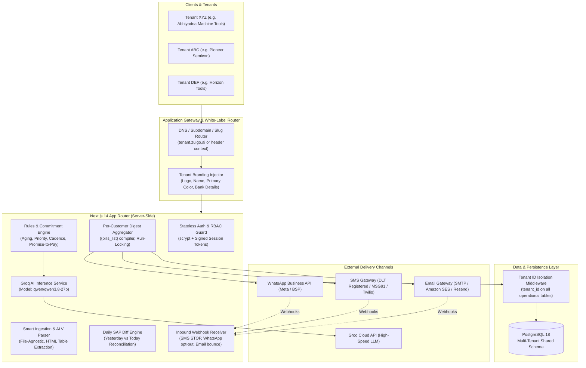
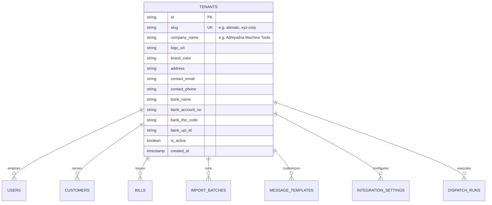
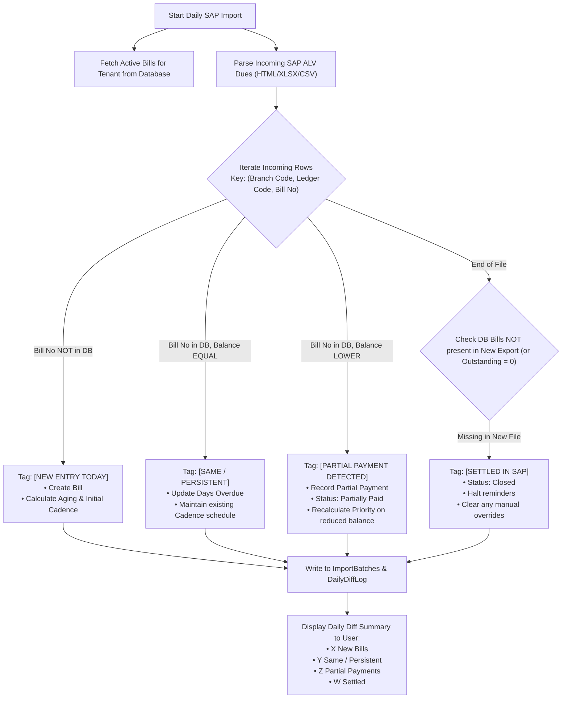
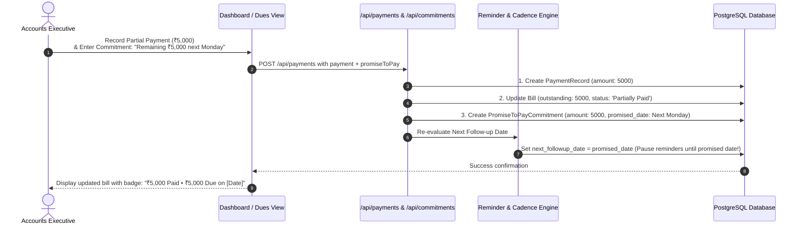
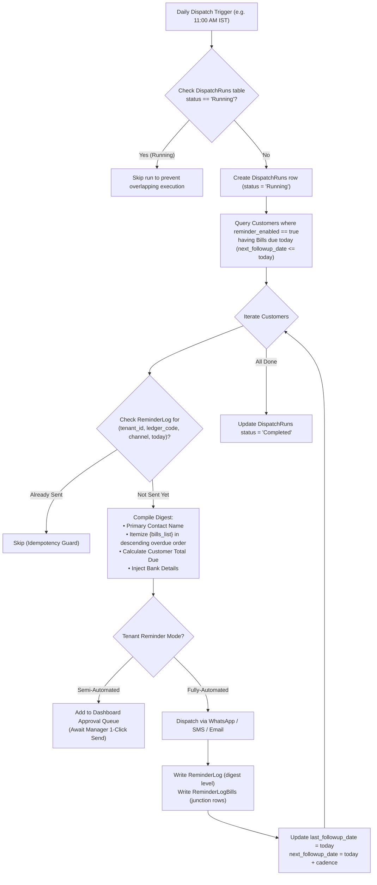

# Payment Follow-up Automation — System Architecture & Technical Design

> **Document:** `docs/ARCHITECTURE.md`  
> **System:** Zuigo Payment Follow-up Automation  
> **Target Deployments:** Multi-Tenant SaaS (White-label per enterprise client)  
> **Pilot Tenant:** Abhiyadna Machine Tools (`ABMATO`)

---

## 1. System Topology & Technology Stack

The platform is designed as a cloud-native, multi-tenant system built on modern web standards with strict transactional integrity:

### Technology Matrix

| Layer | Component | Selection & Justification |
|---|---|---|
| **Frontend & SSR** | Next.js 14.2 (App Router) | High-performance React 18 SSR/CSR, built-in server actions, optimized static and dynamic routing. |
| **Styling & UI** | Tailwind CSS + Lucide Icons | Clean, responsive, enterprise-grade design with dynamic tenant theme variable support. |
| **Application Logic** | TypeScript (Strict Mode) | Type-safe business domain modeling preventing runtime financial or date errors. |
| **Database** | PostgreSQL 18 | Strict ACID guarantees, exact NUMERIC decimal precision for currency, JSONB for integration configurations, and transactional lock support. |
| **ORM** | Prisma ORM 5 | Type-safe relational modeling, migrations, connection pooling, and multi-tenant query extension. |
| **AI Engine** | Groq API (`qwen/qwen3.8-27b`) | Sub-second inference latency generating personalized, aging-adapted collection messages. |
| **Authentication** | Node.js `crypto.scrypt` | Per-user salted password hashing with secure, HTTP-only, signed session cookies. |

---

## 2. Multi-Tenancy & White-Label Architecture

The system is built from the ground up for multi-tenant white-label delivery. Shipping the application to Company XYZ displays XYZ's logo and company name; shipping to Company ABC displays ABC's branding without any cross-tenant data leakage.

### 2.1 Tenant Resolution
1. **Subdomain / Path / Header Resolution:** The tenant context is extracted from the request host (e.g., `abmato.zuigo.ai`), a query parameter, or a secure session claim.
2. **Dynamic UI Injection:**
   - Sidebar and Login pages render the active tenant's `company_name` and `logo_url`.
   - The primary brand color applies dynamically via CSS custom variables (`var(--brand-primary)`).
3. **Template Context Injection:**
   - Reminder messages automatically interpolate `{company_name}` and `{bank_details}` from the active tenant's profile.
4. **Data Isolation:**
   - Every operational query is automatically scoped with `where: { tenantId }`. Cross-tenant querying is strictly prohibited at the Prisma middleware layer.

---

## 3. Daily SAP Export Diffing Engine (Yesterday vs. Today)

Each morning, the accounts user uploads the latest SAP export. Rather than a dumb overwrite, the **Diff Engine** compares the incoming dataset against yesterday's active records:

### Diff Classification Table

| State Detected | Database Condition | System Action | UI Badge |
|---|---|---|---|
| **New Entry Today** | `bill_no` exists in incoming file, but not in DB. | Insert new `Bill`, calculate aging bucket and initial reminder cadence date. | `[NEW TODAY]` (Blue) |
| **Same / Persistent** | `bill_no` exists in both; `incoming.outstanding == db.outstanding`. | Update `days_overdue` and `aging_bucket`. Keep existing cadence schedule intact. | `[PERSISTENT]` (Slate) |
| **Partial Payment** | `bill_no` exists in both; `incoming.outstanding < db.outstanding`. | Set `previous_outstanding_amount = db.outstanding`. Update `outstanding_amount = incoming.outstanding`. Auto-create `PaymentRecord`. Set status to `Partially Paid`. | `[PARTIAL PAID]` (Amber) |
| **Settled in SAP** | `bill_no` exists in DB with balance $>0$, but is absent in new export or has balance $\le 0$. | Set `status = "Payment Received – SAP Confirmed"` / `Closed`. Cancel upcoming reminders. Unflag customer if total outstanding reaches 0. | `[SETTLED IN SAP]` (Emerald) |

---

## 4. Partial Payment & Promise-to-Pay (PTP) Workflow

When a customer pays partially and commits to a date for the remainder (e.g., pays ₹5,000 out of ₹10,000, promising the remaining ₹5,000 next week):

1. **Commitment Tracking:** Stored in `PromiseToPayCommitment` with `promised_amount`, `promised_date`, `recorded_by`, and `notes`.
2. **Automatic Reminder Pause:** Reminders are automatically suppressed until `promised_date`.
3. **Commitment Matured:** On `promised_date`, if the balance remains unpaid, the Cadence Engine automatically resumes the digest reminder schedule.

---

## 5. Daily Per-Customer Digest Messaging Pipeline

Reminders are sent once per customer per channel per day, bundling every open bill into a single digest message.

---

## 6. Next-Day SAP Reconciliation & 7-Day Grace Period

When an accounts executive marks a bill as "Payment Received" via the dashboard, this system immediately halts reminders. The daily morning SAP export reconciles this state:

1. **Manual Mark:** `manual_override = true`, `manual_marked_date = today`, `grace_period_expires_on = today + 7 days`. Reminders halt immediately.
2. **Next SAP Import - Confirmed:** Bill disappears from export or has balance $\le 0$ $\rightarrow$ mark `Closed`, confirmed in SAP.
3. **Next SAP Import - Pending SAP Processing (Within 7 Days):** Bill still appears with balance $> 0$. Reminders remain suppressed under status `Payment Received – Pending SAP Confirmation`.
4. **Next SAP Import - Grace Period Expired (> 7 Days):** If bill remains outstanding after 7 days, it automatically escalates to the **Dashboard Exceptions View** for accounts investigation.
