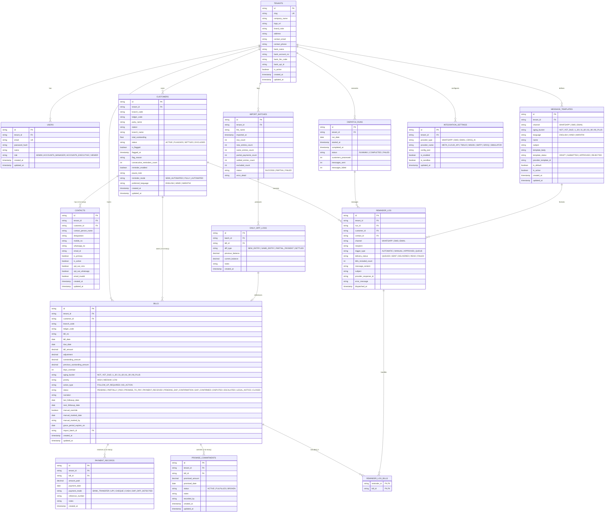

# Payment Follow-up Automation — Database Schema & Data Dictionary

> **Document:** `docs/DATABASE_SCHEMA.md`  
> **Database:** PostgreSQL 18  
> **ORM:** Prisma ORM  
> **Primary Design Constraints:** Multi-Tenant Isolation, Decimal Precision, Composite Natural Keys (`(tenant_id, branch_code, ledger_code)` and `(tenant_id, branch_code, ledger_code, bill_no)`).

---

## 1. Entity-Relationship (ER) Diagram



---

## 2. Key Relational Constraints & Indexes

### 2.1 Composite Natural Keys
1. **Customer Natural Key:**
   ```sql
   UNIQUE (tenant_id, branch_code, ledger_code)
   ```
   Ensures that across any tenant and branch, each `Ledger Code` references exactly one customer.

2. **Bill / Invoice Natural Key:**
   ```sql
   UNIQUE (tenant_id, branch_code, ledger_code, bill_no)
   ```
   Prevents duplicate bill generation when daily SAP exports are re-uploaded.

### 2.2 Dispatch Idempotency Index
```sql
UNIQUE (tenant_id, branch_code, ledger_code, channel, DATE(dispatched_at))
```
Enforces that a customer cannot receive more than one digest reminder per channel on any single calendar day, protecting the business relationship from duplicate messaging.

### 2.3 Performance & Query Optimization Indexes
- `CREATE INDEX idx_bills_due_status ON Bills (tenant_id, next_followup_date, status, action_type);`
- `CREATE INDEX idx_bills_customer ON Bills (tenant_id, customer_id);`
- `CREATE INDEX idx_contacts_customer ON Contacts (customer_id, is_active, is_primary);`
- `CREATE INDEX idx_diff_batch ON DailyDiffLogs (batch_id);`
- `CREATE INDEX idx_commitments_bill ON PromiseCommitments (bill_id, status);`
